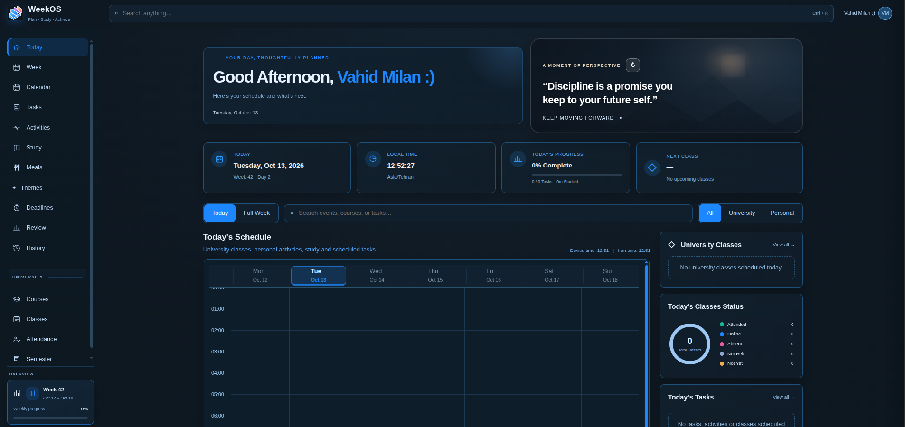

# WeekOS — Weekly Planning Dashboard

A modern and organized dashboard designed to help users manage their weekly plans, tasks, and daily progress.

## Preview



## Features

- Weekly planning and task organization
- Daily progress tracking
- Dashboard interface
- Modular CSS and JavaScript structure
- Responsive design components

## Project Structure

- `index.html` — Main application page
- `css/` — Styles and themes
- `js/` — Application logic and features
- `assets/` — Images and other resources
- `docs/` — Project documentation
- `tests/` — Testing resources

## Getting Started

Clone the repository:

```bash
git clone https://github.com/vahid-milan-dev/WeekOS.git
```

Open the project folder and launch `index.html` in your browser.

## Repository

[View WeekOS on GitHub](https://github.com/vahid-milan-dev/WeekOS)

---

Developed by [vahid-milan-dev](https://github.com/vahid-milan-dev).
